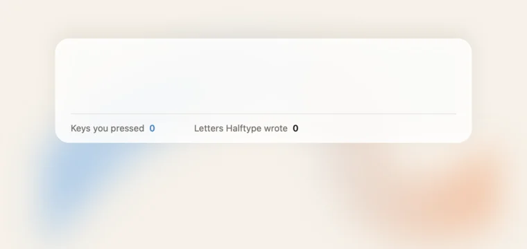

# Halftype

**Inline typing suggestions for your whole Mac, in Korean and English, from a model that runs on your machine.** Grey text appears as you type, in almost any app. Press Tab to take it. What you type stays on your Mac. Halftype saves counts for its Stats and, so a [Personal Model](#privacy) can learn from it, what you type, encrypted, unless you turn that off. Personal Model, a paid option, trains a copy of the model on how you write. You type half; it writes the rest. (It was called Itda until 2026-11.)



The two keys: Tab takes the next word, Shift-Tab the whole suggestion, and a wrong one goes as you keep typing. The suggestions are ones Halftype gives in everyday use. Across whole messages, at the defaults, it saves about a fifth of keystrokes in English ([below](#why-its-different)). It's drawn by [`scripts/demo.sh`](scripts/demo.sh) with the app's own suggestion layout, not screen-recorded.

## Install

**[Download Halftype.dmg](https://github.com/hrsong99/halftype/releases/latest/download/Halftype.dmg)**, open it, and drag Halftype to Applications. Or:

```sh
brew tap hrsong99/halftype && brew trust hrsong99/halftype
brew install --cask halftype
```

You need macOS 26 on Apple Silicon. Open Halftype: a short welcome asks for Accessibility, with a card beside System Settings showing which switch to flip, and fetches a 3.4 GB model once in the meantime. Then three quick lessons, one each for Tab, Shift-Tab and Esc, on suggestions that need no model yet.

It keeps itself up to date, with signed and notarized releases. Turn off Update Automatically under General and it only tells you, with a dot on its menu-bar icon, when there's a new version. To build it yourself, with Swift 6.2 (Xcode 26), run `scripts/build-app.sh` and open `build/Halftype.app`.

**[Get early-bird news](https://halftype.app/pro)**: an email or two a month at most, and a note when Personal Model ships: a model that learns how you write, for $4 a month. Or sign up under General in the app.

| The window | Your models |
|---|---|
|  |  |

| How much it typed for you (Stats; these counts are made up) |
|---|
|  |

## Use

| Key | What it does |
|---|---|
| **Tab** | Takes the next word |
| **Shift-Tab** | Takes the whole suggestion |
| **Esc** | Hides the suggestion and does nothing else, so Tab moves between fields again. The next Esc goes to the app |

Or keep typing: the suggestion follows along while you match it. With no suggestion showing, these keys do what they always do.

The window opens on that field alone, with the model and an on/off button inside it. Scroll down for the rest, in one page: stats, models to download, switch between or delete, paused apps, and Start at Login. A card at the side jumps between them; the sidebar icon opens or shuts it. Close the window and Halftype stays in the menu bar, whose icon also pauses it for the current app. Open Halftype again to get the window back.

The menu-bar icon dims when Halftype is off or paused for the app in front, shows a dot when something needs you, and a percentage while the model downloads. Its menu says in one line why there's no suggestion where you are. Most often that's "Working. Not sure enough to suggest yet.": Halftype stays quiet until it's sure. The same line shows under the window's field. If macOS's own grey predictions are on, the window says so and links to the setting; Halftype never changes it.

## Why it's different

Most tools in this category go quiet while you compose Hangul, or suggest from a half-built syllable. We read the source of [66 open-source projects](docs/audit.md) and found none that completes through a composing syllable. Three things do the work:

**It won't guess at the half-typed word.** The prompt stops at the last whole word and the model has to reproduce what you've typed so far. Across 130 paired mid-word English positions on a Gemma model, a useful suggestion went from 7.7% to 50.8%. The shipped mask on the default model wasn't compared this way.

**It suggests whenever it has a guess, and you choose how sure it must be.** A wrong suggestion is easy to ignore and a right one saves keys, so by default (Suggestions: Always, Length: Long) Halftype shows its best guess whenever it has one that saves at least one keystroke. In a replay of 120 of the author's English messages that saved 10.2 points more keystrokes than the old, cautious defaults, and 9.8 more on public Korean, while about a third of what it showed in English was right, against 71% before. Suggestions' When Sure brings the old gate back: the first word's probability, among words that fit what you've typed, must clear one threshold, and on 2,400 held-out English requests the first word shown was then right 82.3% of the time with Gemma 4 E2B. Length's Short ends a suggestion before the first word it's unsure of. The window's Try It field always runs with no gate and no floor, to show what the model would say.

**It finishes Korean with real key presses.** The syllable you're composing stays out of the prompt, the model's output must fit its 2-set keys (so `하` allows `한` or `함`), and Tab presses the remaining keys so the input method finishes the syllable itself. On 1,099 requests mid-syllable in public Korean text, keystrokes saved per request went from 0 when sending the syllable to the model to 0.69. It costs more wrong suggestions: 18.2% of those requests, against 8.4%.

Across whole messages, replayed with real typing delays, Gemma 4 E2B at the default settings saved **28.6% of keystrokes in English** (1,200 keys of the author's messages), against 19.6% at the old ones. Its Korean wasn't replayed on whole messages; on 70 of the author's own messages it took 0.54 keys per request by Tab, against 0.60 for Qwen 3.5 0.8B and 1.03 for Kanana 1.5. Qwen 3.5 0.8B saved 4.8% in Korean (1,200 keys of public text) and 10.8% on the author's messages; Kanana 1.5, one click away in the window, saves the most in Korean: 8.8% and 13.4%. A match has to be exact, so a good paraphrase scores zero. The English messages are the author's and aren't published. Method and more numbers: [docs/measuring.md](docs/measuring.md). The design: [docs/how-it-works.md](docs/how-it-works.md).

## What it costs

Measured on an M5 with 16 GB, running the real app path on a test window with `scripts/e2e.sh --measure`, with Gemma 4 E2B, the default, on 2026-11-09. [Details](docs/measuring.md).

| State | Memory |
|---|---|
| Typing, and for 15 s after | about **1.5 GB wired**, plus about 240 MB of footprint |
| Stopped, model still loaded, up to 5 minutes | 180 MB footprint, nothing wired |
| Unloaded, after 5 idle minutes | **79 MB** |

Wired memory is what counts: nothing else can use it, and Activity Monitor's per-app number leaves it out. Look at its Wired line.

- Only part of Gemma's 3.4 GB file is wired; the rest is mapped and can be evicted. Other models wire about their file size: Qwen 3.5 0.8B 0.56 GB, Kanana 1.5 1.5 GB.
- **Disk:** a 3.4 GB model and an app of about 27 MB.
- **CPU:** 0.16-0.93% of a core idle with the model loaded. 14% while typing about 5 keys a second (Qwen 3.5 0.8B: 7-8%).
- **Speed:** a suggestion's first displayable word arrives in 71 ms in English with Gemma 4 E2B, and 53 ms in English and 97 ms in Korean with Qwen 3.5 0.8B (p50, requests that got that far, timed replay). With Qwen, no model call at all on 47% of English keys and 20% of Korean, because the suggestion still fits.
- **Power:** not measured.

## Privacy

- **One permission: Accessibility.** The app asks for nothing else, and it never uses Screen Recording.
- **What it reads:** the focused field and text near it in the window, to give the model context. A key tap watches for Tab, Shift-Tab and Esc, and it sees your other keys so it can track Korean composition. All of it stays in memory.
- **What it writes:** the on/off switch, your paused apps and the paths of models you chose as settings, and model files in Application Support, with where a stopped download got to. Also there, for Stats, counts a day: suggestions shown and taken, Tabs, the letters, words and keys Tab typed, the keys you typed, and the seconds spent typing them (only gaps under 2 s, summed, for your typing speed), plus whether your personal model ran. No per-key timings and no logs. With Personal Model, its trained files too (below). What you type in its own window is held in memory until the window closes.
- **Saved typing, to train your Personal Model:** what you add to a field, once you leave it or it empties (a message sent), with the text on screen before it (up to 1,200 characters, often the other person's messages), and the date. Only two words or more, typed by keys or Tab: a visit with a paste in it, or text another app put there, isn't kept; never from secure fields, paused apps or Halftype's own window. It's on by default, and shown, with what it keeps, under General (not in setup). Turn it off, choose how long it's kept (1 month, 6 months by default, 1 year or all), see it with Show, or Delete All under General. It's one file, `typing.sealed` in Application Support, readable only by you and excluded from backups, each record encrypted with AES-GCM under a key in your Keychain that never leaves this Mac; Delete All removes both. It never goes into logs or Stats, and it's sent only for a training run you start.
- **Network:** only the models you fetch, from Hugging Face, each checked by SHA-256: the default on first run, and the others when you press Get. And GitHub, about once a day in a release build, to check for an update, which sends your macOS version and Halftype's, and to fetch it unless Update Automatically is off under General. And, only if you press Notify Me under General, the email address you typed there, to the early-bird list (a Google Form). Nothing else, unless you turn on Personal Model (below). A build you make yourself never checks. GitHub's download counts, for the app and for these checks, are the only usage numbers the author sees.
- **Personal Model (paid, coming soon, and off unless you turn it on):** a copy of the model trained on how you write. You choose what it learns from, and nothing is sent until you do. That text goes encrypted (TLS) to a rented GPU (Modal), is used for that one training run and deleted when it ends, with no copy kept. Nobody reads it, and the logs hold only counts. What comes back is the trained file, kept on your Mac. It's made from your writing and can repeat bits of it, so treat it like your messages. Turn it off or delete it any time under General > Personal Model. The Halftype you can download today has no training upload and sends none of your text.
- **Secure fields** are skipped: Halftype checks the field before every read, and reads no text from a secure one or suggests in it. While any app holds Secure Input, it starts no new read or suggestion, and checks again just before drawing; a suggestion already on screen goes at the next change it sees. The menu says so.

## Uninstall

Quit Halftype from its menu, drag it from Applications to the Trash, and remove `~/Library/Application Support/Halftype`, which holds the models and your saved typing, and the Keychain item "Halftype saved typing" (Delete All under General removes both). Its settings are in `~/Library/Preferences/app.halftype.Halftype.plist`. With Homebrew, `brew uninstall --zap --cask halftype` does all of it. To remove only a model, use Delete under Models in its window.

## Limits

- **macOS 26 or later.** Only tested on Apple Silicon, on one M5.
- **Korean accept needs Apple's 2-Set Korean layout.** With another Korean layout, Halftype shows nothing after a Hangul character, because a composition could swallow what it inserts.
- **Korean is the weak spot.** The accuracy figures come mostly from public dialogue text. There, about a fifth of Korean suggestions shown by Qwen 3.5 0.8B match exactly (21%; Gemma 4 E2B, the default, wasn't measured this way), a third with Kanana 1.5 or Qwen 3.5 2B (31-34%), and raising the threshold doesn't help; about half of the wrong ones are near misses. English is much better.
- **No suggestion with text after the caret on the same line.** Halftype continues at the end of a line; with text below, the suggestion stays on one line.
- **No suggestion during Secure Input.** While a password prompt, a password manager or Terminal's Secure Keyboard Entry holds it, Tab can't reach Halftype, so it stops until that ends.
- **A build you make yourself** without a stable signing identity asks for Accessibility again after each rebuild. Releases don't.

## Status

An early release, used so far by its author. Unit tests cover the logic, and `scripts/e2e.sh` checks the app against a private window, including every composing state of 17 hard words through the live 2-set input method in a native field.

Korean has been used by hand in T3 Code, a Chromium app, and works, though the suggestions are weaker than in English. Other Chromium apps, and most of the hand checklist in [docs/live-test.md](docs/live-test.md), haven't been run yet. Please open an issue with what you find.

## More

- [How it works](docs/how-it-works.md)
- [How the numbers were measured](docs/measuring.md)
- [What 66 open-source projects taught us](docs/audit.md)
- [Credits](CREDITS.md). The ideas are from many people; every one is named there.
- [MIT licence](LICENSE)

## 한국어 요약

Halftype은 한국어와 영어를 쓰는 사람을 위한 macOS 인라인 자동완성 앱입니다. 입력 중에 회색 글자로 다음 말을 제안합니다. 모델은 내 Mac에서만 돌아갑니다.

- **사용법:** 회색 글자가 제안입니다. Tab은 다음 단어, Shift-Tab은 전체, Esc는 닫기입니다.
- **다른 점:** 조합 중인 글자를 모델에 보내지 않고, 두벌식 키 입력에 맞는 결과만 받습니다. Tab을 누르면 남은 키를 실제로 눌러 입력기가 글자를 마저 조합합니다.
- **비용:** 기본 모델 Gemma 4 E2B는 입력 중과 그 후 15초 동안 약 1.5 GB를 점유하고(wired), 5분 쉬면 모델을 내려 79 MB로 줄어듭니다. 모델은 처음 한 번 3.4 GB를 받습니다.
- **개인정보:** 손쉬운 사용 권한만 씁니다. 네트워크는 모델 다운로드와 업데이트 확인(일반 설정에서 끌 수 있음)에만 쓰고, 지금은 입력한 글을 저장하지 않고 횟수만 셉니다(통계 페이지용). 나중에 개인 모델이 학습용으로 입력한 글을 저장할 수 있지만, 직접 켰을 때만이며 언제든 지울 수 있습니다. 비밀번호 칸은 건너뜁니다. 개발자가 보는 사용 통계는 GitHub의 다운로드 횟수(앱과 업데이트 확인)뿐입니다.
- **설치:** [Halftype.dmg](https://github.com/hrsong99/halftype/releases/latest/download/Halftype.dmg)를 내려받거나 `brew tap hrsong99/halftype && brew trust hrsong99/halftype` 후 `brew install --cask halftype`를 실행하세요. 자동으로 업데이트됩니다.
- **제거:** Halftype을 종료하고 휴지통으로 옮긴 뒤 `~/Library/Application Support/Halftype`를 지우세요. Homebrew라면 `brew uninstall --zap --cask halftype`.
- **한계:** macOS 26 이상, Apple Silicon, 두벌식이 필요합니다. 한국어 정확도는 영어보다 낮습니다. Qwen 3.5 0.8B는 공개 대화 데이터에서 보여 준 제안의 21%가 정확히 일치했고, 전체 메시지 기준으로 키 입력을 4.8% 줄였습니다. 기본 모델 Gemma 4 E2B는 한국어에서 이보다 약간 약합니다. 한국어를 많이 쓴다면 창에서 Kanana 1.5를 고르세요(31-34%, 8.8%).
