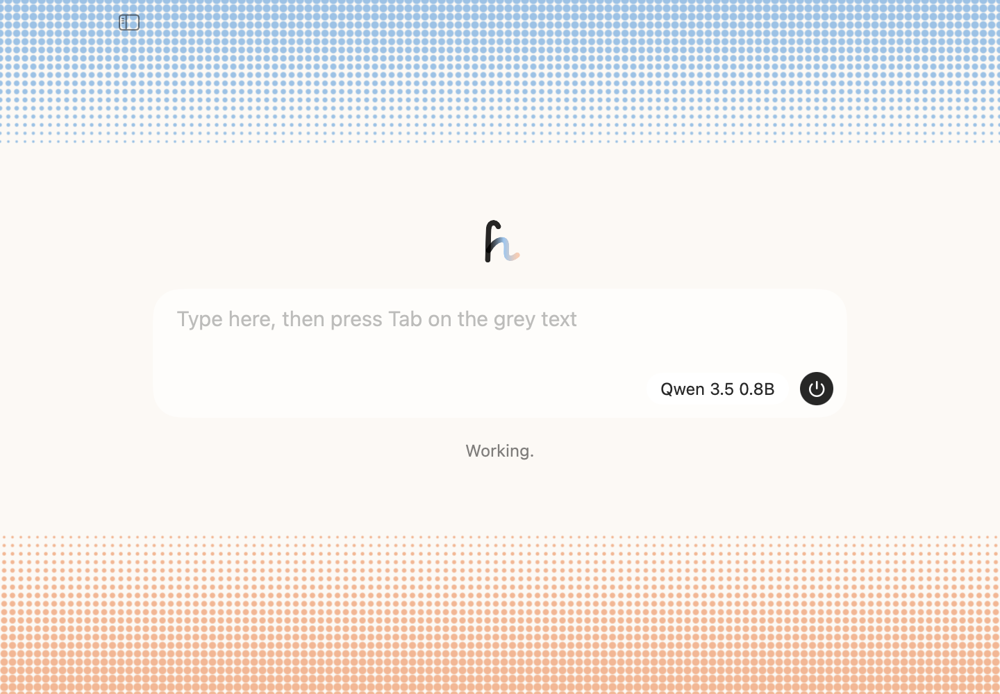
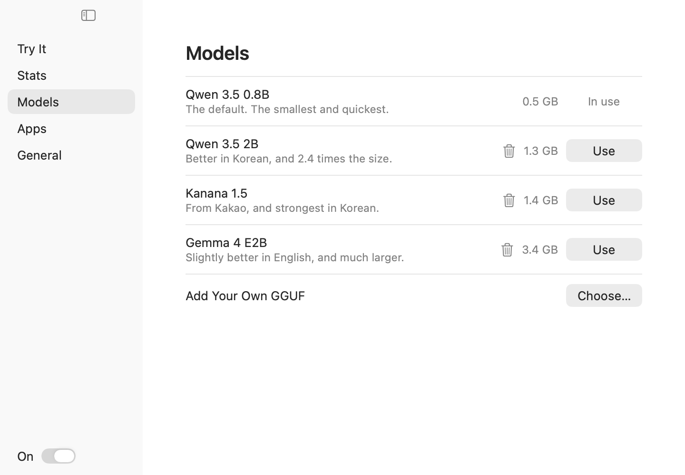
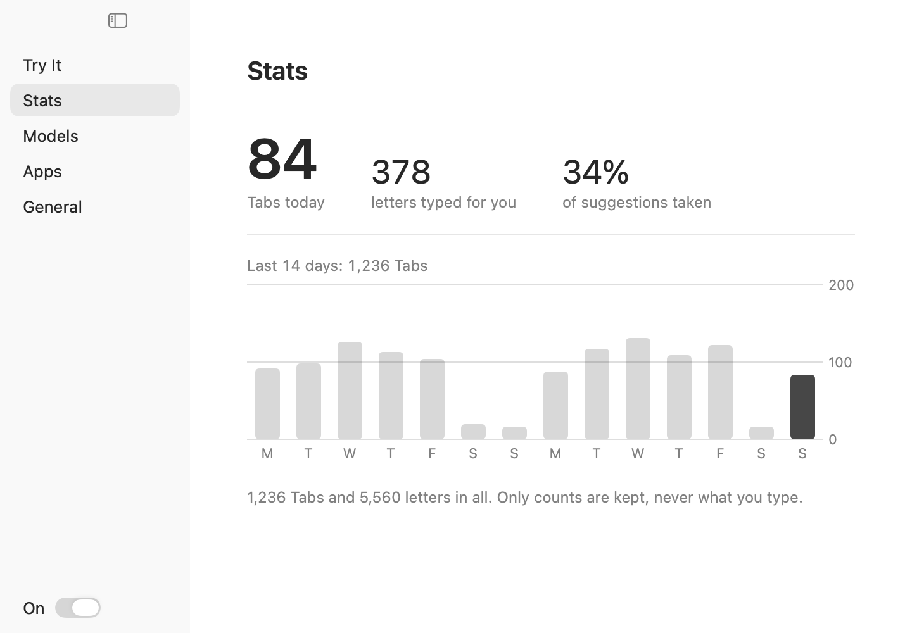

# Itda (잇다)

**Inline typing suggestions for your whole Mac, in Korean and English, from a model that runs on your machine.** Grey text appears as you type, in almost any app. Press Tab to take it. What you type never leaves your Mac and is never saved: Itda keeps only counts, for its Stats page. *Itda* means "to continue, to join".


These sentences are ones it does well on, and suggestions aren't always this good. They're drawn from the real model and the real ghost text by [`scripts/demo.sh`](scripts/demo.sh), not screen-recorded.

## Install

**[Download Itda.dmg](https://github.com/hrsong99/itda/releases/latest/download/Itda.dmg)**, open it, and drag Itda to Applications. Or:

```sh
brew tap hrsong99/itda && brew trust hrsong99/itda
brew install --cask itda
```

You need macOS 26 on Apple Silicon. Open Itda: its window asks for Accessibility, fetches a 0.5 GB model once, and gives you a field to try it in.

It keeps itself up to date, with signed and notarized releases. Turn that off under General. To build it yourself, with Swift 6.2 (Xcode 26), run `scripts/build-app.sh` and open `build/Itda.app`.

| The window | Your models |
|---|---|
|  |  |

| How much it typed for you (Stats; these counts are made up) |
|---|
|  |

## Use

| Key | What it does |
|---|---|
| **Tab** | Takes the next word |
| **Shift-Tab** | Takes the whole suggestion |
| **Esc** | Hides the suggestion, so Tab moves between fields again |

Or keep typing: the suggestion follows along while you match it. With no suggestion showing, these keys do what they always do.

The window opens on that field alone, with the model and an on/off button inside it. The sidebar icon reveals the rest: models to download or switch between, paused apps, and Start at Login. Close the window and Itda stays in the menu bar, whose icon also pauses it for the current app. Open Itda again to get the window back.

## Why it's different

Most tools in this category go quiet while you compose Hangul, or suggest from a half-built syllable. We read the source of [66 open-source projects](docs/audit.md) and found none that completes through a composing syllable. Three things do the work:

**It won't guess at the half-typed word.** The prompt stops at the last whole word and the model has to reproduce what you've typed so far. Across 130 paired mid-word English positions on a Gemma model, a useful suggestion went from 7.7% to 50.8%. The shipped mask on the default model wasn't compared this way.

**It stays quiet when the model isn't sure.** Itda shows a suggestion only if the first word's probability, among words that fit what you've typed, clears one threshold. On 2,400 held-out English requests with the default model, the first word shown was right 81.5% of the time (922 of 1,131), at 47.1% coverage. With no gate, 50-53% were right. It also ends a suggestion before the first word it's unsure of, and doesn't show one that would save under three keystrokes. In the same replay on Kanana 1.5, that took the grey characters that were right from 19% to 75%. Both are settings under General, Length and How Often, and these numbers are for the defaults.

**It finishes Korean with real key presses.** The syllable you're composing stays out of the prompt, the model's output must fit its 2-set keys (so `하` allows `한` or `함`), and Tab presses the remaining keys so the input method finishes the syllable itself. On 1,099 requests mid-syllable in public Korean text, keystrokes saved per request went from 0 when sending the syllable to the model to 0.69. It costs more wrong suggestions: 18.2% of those requests, against 8.4%.

Across whole messages, replayed with real typing delays before the latest change to how much a suggestion shows, the default model saved **21.6% of keystrokes in English** (800 keys) and **4.8% in Korean** (1,200 keys of public text), or 10.8% on 70 of the author's own messages. Kanana 1.5, one click away in the window, saves more in Korean: 8.8% and 13.4%. A match has to be exact, so a good paraphrase scores zero. The English messages are the author's and aren't published. Method and more numbers: [docs/measuring.md](docs/measuring.md). The design: [docs/how-it-works.md](docs/how-it-works.md).

## What it costs

Measured on an M5 with 16 GB, running the real app path on a test window with `scripts/e2e.sh --measure`, with the default model. [Details](docs/measuring.md).

| State | Memory |
|---|---|
| Typing, and for 15 s after | about **0.56 GB wired**, plus about 270 MB of footprint |
| Stopped, model still loaded, up to 5 minutes | 250 MB footprint, nothing wired |
| Unloaded, after 5 idle minutes | **79 MB** |

Wired memory is what counts: nothing else can use it, and Activity Monitor's per-app number leaves it out. Look at its Wired line.

- A larger model in the window wires about its file size: Kanana 1.5, 1.5 GB.
- **Disk:** a 0.5 GB model and an app of about 27 MB.
- **CPU:** 0.13-0.27% of a core idle over 60 s. 7-8% while typing about 5 keys a second.
- **Speed:** a suggestion's first displayable word arrives in 53 ms in English and 97 ms in Korean (p50, requests that got that far, timed replay). No model call at all on 47% of English keys and 20% of Korean, because the suggestion still fits.
- **Power:** not measured.

## Privacy

- **One permission: Accessibility.** The app asks for nothing else, and it never uses Screen Recording.
- **What it reads:** the focused field and text near it in the window, to give the model context. A key tap watches for Tab, Shift-Tab and Esc, and it sees your other keys so it can track Korean composition. All of it stays in memory.
- **What it writes:** the on/off switch, your paused apps and the paths of models you chose as settings, and model files in Application Support. Nothing with typed text, and no logs. What you type in its own window is held in memory until the window closes.
- **Network:** only the models you fetch, from Hugging Face, each checked by SHA-256: the default on first run, and the others when you press Get. And GitHub, about once a day in a release build, to check for an update and fetch it, which sends your macOS version and Itda's. Turn that off under General. Nothing else. A build you make yourself never checks.
- **Secure fields** are skipped: Itda doesn't read them or suggest in them.

## Limits

- **macOS 26 or later.** Only tested on Apple Silicon, on one M5.
- **Korean accept needs Apple's 2-Set Korean layout.** With another Korean layout, Itda shows nothing after a Hangul character, because a composition could swallow what it inserts.
- **Korean is the weak spot.** The accuracy figures come mostly from public dialogue text. There, about a fifth of Korean suggestions shown by the default model match exactly (21%), a third with Kanana 1.5 or Qwen 3.5 2B (31-34%), and raising the threshold doesn't help; about half of the wrong ones are near misses. English is much better.
- **No suggestion with text after the caret.** Itda only continues at the end of a field's text.
- **A build you make yourself** without a stable signing identity asks for Accessibility again after each rebuild. Releases don't.

## Status

An early release, used so far by its author. Unit tests cover the logic, and `scripts/e2e.sh` checks the app against a private window, including every composing state of 17 hard words through the live 2-set input method in a native field.

Korean has been used by hand in T3 Code, a Chromium app, and works, though the suggestions are weaker than in English. Other Chromium apps, and most of the hand checklist in [docs/live-test.md](docs/live-test.md), haven't been run yet. Please open an issue with what you find.

## More

- [How it works](docs/how-it-works.md)
- [How the numbers were measured](docs/measuring.md)
- [What 66 open-source projects taught us](docs/audit.md)
- [Credits](CREDITS.md). The ideas are from many people; every one is named there.
- [MIT licence](LICENSE)

## 한국어 요약

잇다는 한국어와 영어를 쓰는 사람을 위한 macOS 인라인 자동완성 앱입니다. 입력 중에 회색 글자로 다음 말을 제안합니다. 모델은 내 Mac에서만 돌아갑니다.

- **사용법:** 회색 글자가 제안입니다. Tab은 다음 단어, Shift-Tab은 전체, Esc는 닫기입니다.
- **다른 점:** 조합 중인 글자를 모델에 보내지 않고, 두벌식 키 입력에 맞는 결과만 받습니다. Tab을 누르면 남은 키를 실제로 눌러 입력기가 글자를 마저 조합합니다.
- **비용:** 입력 중과 그 후 15초 동안 약 0.56 GB를 점유하고(wired), 5분 쉬면 79 MB로 줄어듭니다. 모델은 처음 한 번 0.5 GB를 받습니다.
- **개인정보:** 손쉬운 사용 권한만 씁니다. 네트워크는 모델 다운로드와 업데이트 확인(일반 설정에서 끌 수 있음)에만 쓰고, 입력한 글은 저장하지 않고 횟수만 셉니다(통계 페이지용). 비밀번호 칸은 건너뜁니다.
- **설치:** [Itda.dmg](https://github.com/hrsong99/itda/releases/latest/download/Itda.dmg)를 내려받거나 `brew tap hrsong99/itda && brew trust hrsong99/itda` 후 `brew install --cask itda`를 실행하세요. 자동으로 업데이트됩니다.
- **한계:** macOS 26 이상, Apple Silicon, 두벌식이 필요합니다. 한국어 정확도는 영어보다 낮습니다. 기본 모델은 공개 대화 데이터에서 보여 준 제안의 21%가 정확히 일치했고, 전체 메시지 기준으로 키 입력을 4.8% 줄였습니다. 한국어를 많이 쓴다면 창에서 Kanana 1.5를 고르세요(31-34%, 8.8%).
